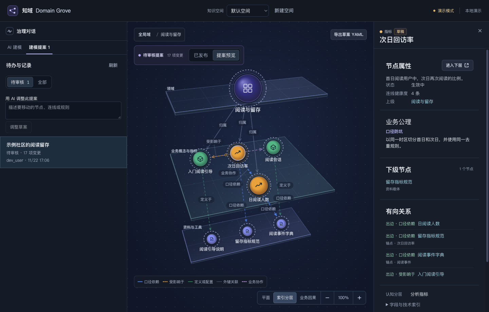
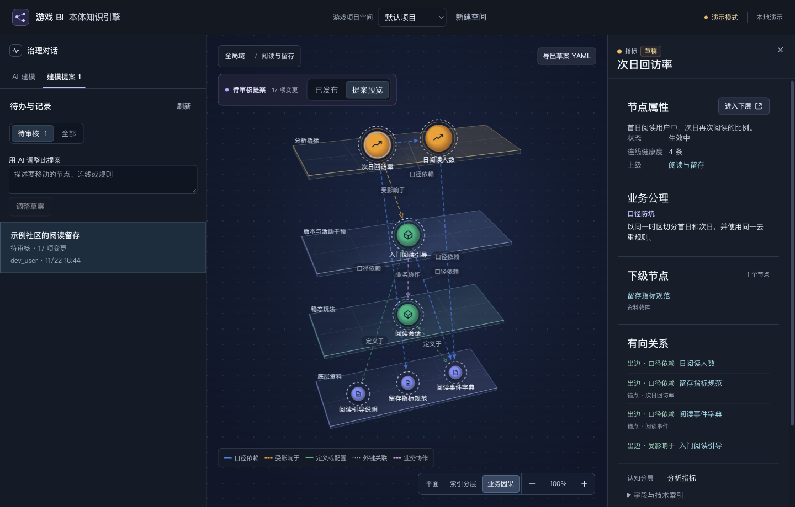
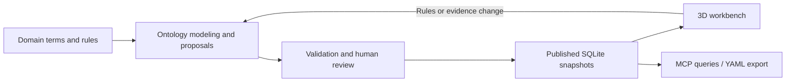

<div align="center">

# Domain Grove

**Maintain traceable business knowledge over time with ontology modeling and domain-driven design (DDD).**

[English](README.en.md) · [简体中文](README.md) · [Quick start](#quick-start) · [Modeling](#how-knowledge-evolves)

[](#quick-start)
[](https://github.com/shanghe000/domain-grove/actions/workflows/quality.yml)
[](LICENSE)



<sub>Screenshot of the running workbench using the bundled fictional reading community.</sub>

</div>

## How knowledge evolves

In fulfillment, an order may be complete upon delivery. In finance, it may be complete upon settlement. Domain Grove records terms, rules, and evidence within their own business context so teams can see where a rule applies, what supports it, and when it changed.

| Capability | What you can do |
| --- | --- |
| **Set bounded contexts** | Give distinct business models their own knowledge spaces, with separate graphs, review queues, and published revisions. |
| **Model the domain** | Assign stable IDs to domains, concepts, metrics, and sources. Use directed relationships for dependencies and business axioms for conditions and exceptions. |
| **Trace the evidence** | Explore the 3D graph and follow definitions to document sections, table fields, or an event dictionary. The workbench and MCP clients share the graph traversal logic. |
| **Review and evolve** | Propose changes to rules and evidence, review the candidate graph, and publish a new revision. MCP traversal can retrieve earlier revisions by number. |

<details>
<summary>See the business causality view</summary>



<sub>The same example in the causality view, connecting metrics, mechanisms, and evidence.</sub>

</details>

## Quick start

Requires **Go 1.25+**, **Node.js 22.12+**, and **Python 3**. The workbench interface uses Simplified Chinese.

1. Clone the repository, build the frontend, and start the workbench.

   ```sh
   git clone https://github.com/shanghe000/domain-grove.git
   cd domain-grove
   npm ci --prefix web
   npm run build --prefix web

   sample_data="$(mktemp -d)"
   AUTH_ENABLED=false ONTOLOGY_MODE=index INDEX_ALLOW_DEV_REVIEW=true \
     GO_SERVER_ADDR=127.0.0.1:8080 PUBLIC_URL=http://127.0.0.1:8080 \
     DATA_DIR="$sample_data" go run ./cmd/server
   ```

2. In a second terminal, submit the bundled synthetic proposal from the same repository directory.

   ```sh
   python3 examples/community/submit.py
   ```

3. Open <http://127.0.0.1:8080>. Under **建模提案** (Modeling proposals), choose **示例社区的阅读留存** (Reading community retention).

## First session

- **Trace a definition.** Double-click **阅读与留存** (Reading and retention), then select **次日回访率** (Next-day return rate). The detail panel shows the definition and links to its evidence.
- **Switch views.** Use the canvas toolbar to choose the flat, index-layer, or causality view. Right-drag in either layered view to rotate the graph.
- **Review and publish.** Choose **返回审核 → 批准并发布 → 确认发布** (Back to review → Approve and publish → Confirm). Approval takes the space from an empty `r0` to its first published revision, `r1`.

Several metrics can share one event dictionary, with each relationship anchored to its own section. [Example proposal](examples/community/proposal.json) · [Metric definition](examples/community/sources/retention.md) · [Event dictionary](examples/community/sources/reading-events.md) · [Onboarding notes](examples/community/sources/onboarding.md)

If a return visit starts requiring a completed reading session, keep the metric ID and submit the updated rule and its evidence in a new proposal. After approval, use the new revision or query the previous revision to see the definition that applied then.

## Data and deployment

SQLite stores graphs, proposals, and published revisions. Graphs locate evidence by repository alias, relative path, and anchor, while source material stays in its original location. The local example binds to loopback and writes synthetic data to a separate temporary directory. Shared deployments configure their own authentication, model service, and MCP credentials. [Configuration reference (Chinese)](docs/CONFIGURATION.md)

## Architecture



Go and SQLite manage knowledge spaces, model validation, and publication. React and Canvas handle 3D exploration and review. An optional DeepSeek integration drafts changes for human approval. [YAML and MCP reference (Chinese)](INDEX-SPEC.md)

## Development

```sh
go test -race ./...
npm ci --prefix web
npm test --prefix web
npm run build --prefix web
```

[Contributing](CONTRIBUTING.md) · [Issues](https://github.com/shanghe000/domain-grove/issues) · [Security](SECURITY.md) · [MIT license](LICENSE) · [Third-party licenses](THIRD_PARTY.md)
