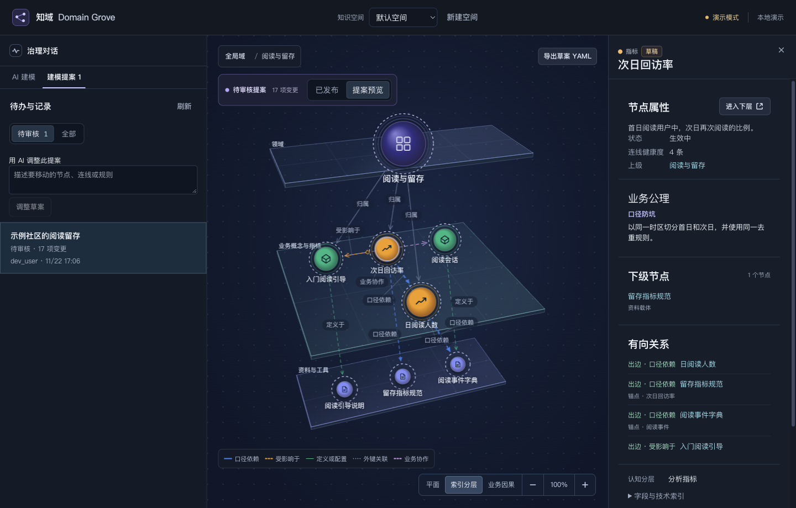
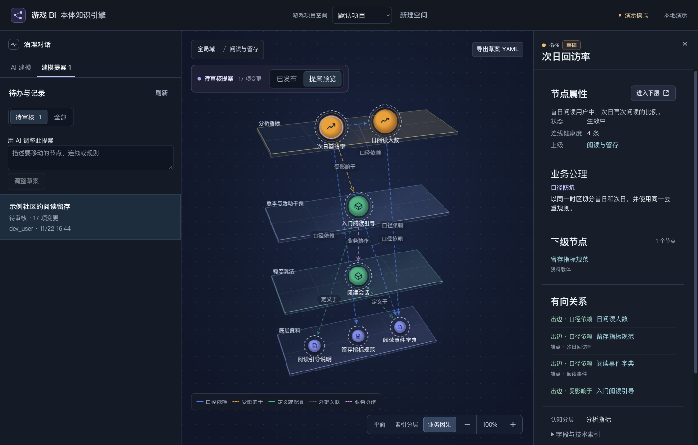
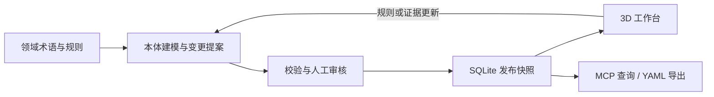

<div align="center">

# 知域 · Domain Grove

**用本体建模和领域驱动设计（DDD），长期维护可追溯的业务知识。**

[简体中文](README.md) · [English](README.en.md) · [快速开始](#运行示例) · [建模规范](INDEX-SPEC.md)

[](#运行示例)
[](https://github.com/shanghe000/domain-grove/actions/workflows/quality.yml)
[](LICENSE)



<sub>工作台实际运行截图，使用项目内的虚构阅读社区数据。</sub>

</div>

## 业务知识如何演进

履约团队可以把「订单已完成」定义为签收，财务团队可以定义为结算。知域把术语、规则及其依据放在各自的业务上下文中，让团队查清一条规则在哪个范围内成立、为什么成立，以及它何时改变。

| 能力 | 可以做什么 |
| --- | --- |
| **划定限界上下文** | 用独立的知识空间管理不同语义。每个空间有自己的图谱、审核队列和发布版本。 |
| **建立本体模型** | 用稳定的标识记录领域、概念、指标和资料。用有向关系表达依赖，用业务公理刻画适用条件和例外。 |
| **沿图谱核对依据** | 在三维画布中下钻，从一条定义追到文档段落、配置表字段或事件字典。工作台和 MCP 使用相同的图谱遍历逻辑。 |
| **审核并演进** | 通过提案变更规则和来源，先审阅候选图谱，再发布新版本。MCP 可按修订号回查旧版图谱。 |

<details>
<summary>查看业务因果视图</summary>



<sub>同一个示例的因果视图，连接指标、业务机制与证据。</sub>

</details>

## 运行示例

需要 **Go 1.25+**、**Node.js 22.12+** 和 **Python 3**。

1. 克隆仓库，构建并启动工作台。

   ```sh
   git clone https://github.com/shanghe000/domain-grove.git
   cd domain-grove
   npm ci --prefix web
   npm run build --prefix web

   sample_data="$(mktemp -d)"
   AUTH_ENABLED=false ONTOLOGY_MODE=index INDEX_ALLOW_DEV_REVIEW=true \
     GO_SERVER_ADDR=127.0.0.1:8080 PUBLIC_URL=http://127.0.0.1:8080 \
     DATA_DIR="$sample_data" go run ./cmd/server
   ```

2. 另开终端，在同一源码目录提交随仓库提供的合成提案。

   ```sh
   python3 examples/community/submit.py
   ```

3. 打开 <http://127.0.0.1:8080>，在「建模提案」里选择「示例社区的阅读留存」。

## 第一次使用

- **追溯一条定义。** 双击「阅读与留存」，单击「次日回访率」。在详情中核对计算口径及其连接的资料出处。
- **切换观察视角。** 画布底部可选「平面」「索引分层」或「业务因果」。在分层视图中右键拖动可旋转图谱。
- **审核并发布。** 选择「返回审核 → 批准并发布 → 确认发布」。批准后，空间从空图 `r0` 进入首个发布版本 `r1`。

同一份事件字典可以支持多个指标，关系上的锚点分别定位到各自的段落。[示例提案](examples/community/proposal.json) · [指标规范](examples/community/sources/retention.md) · [事件字典](examples/community/sources/reading-events.md) · [引导说明](examples/community/sources/onboarding.md)

如果回访口径从「打开文章」变为「完成一次有效阅读」，可以沿用同一个指标标识，在新提案中更新规则与证据。批准后使用新版本，仍可按修订号回查旧版定义及其出处。

## 数据与部署

SQLite 保存图谱、提案和发布版本。图谱以仓库别名、相对路径和锚点定位资料，原文由资料来源侧管理。示例在本机回环地址运行，并在独立的临时目录写入合成数据。共享部署的登录、模型和 MCP 凭据由部署方配置。[运行配置](docs/CONFIGURATION.md)

## 架构



Go 和 SQLite 负责项目空间、模型校验及版本发布，React 和 Canvas 提供三维浏览与审核。可选的 DeepSeek 接入可起草候选变更，由维护者审核后发布。[YAML 与 MCP 契约](INDEX-SPEC.md)

## 开发

```sh
go test -race ./...
npm ci --prefix web
npm test --prefix web
npm run build --prefix web
```

[贡献指南](CONTRIBUTING.md) · [问题反馈](https://github.com/shanghe000/domain-grove/issues) · [安全报告](SECURITY.md) · [MIT 许可](LICENSE) · [第三方许可](THIRD_PARTY.md)
