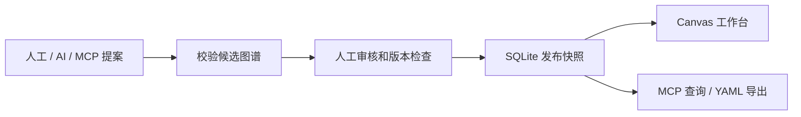

# 游戏 BI 知识本体引擎

把指标、业务概念和资料定位连接为有向图。从指标下钻到关联节点，沿证据箭头核对怎么算、依赖什么、原文在哪里。每个项目空间单独维护图谱、提案和发布版本。


*工作台实际运行截图。演示数据来自虚构的阅读社区。*

## 运行示例

需要 Go 1.25+、Node.js 22.12+ 和 Python 3。以下命令在源码目录构建并启动工作台。

```sh
npm ci --prefix web
npm run build --prefix web
sample_data="$(mktemp -d)"
AUTH_ENABLED=false ONTOLOGY_MODE=index INDEX_ALLOW_DEV_REVIEW=true \
  GO_SERVER_ADDR=127.0.0.1:8080 PUBLIC_URL=http://127.0.0.1:8080 \
  DATA_DIR="$sample_data" go run ./cmd/server
```

另开终端，在同一源码目录运行提交脚本。

```sh
python3 examples/community/submit.py
```

打开 <http://127.0.0.1:8080>，在「建模提案」选择「示例社区的阅读留存」。双击「阅读与留存」下钻，单击「次日回访率」查看节点与资料。画布底部可切换「平面」「索引分层」「业务因果」，在分层视图下右键拖动可旋转。核对后选择「返回审核 → 批准并发布 → 确认发布」，图谱从 `r0` 进入 `r1`。

<details>
<summary>查看业务因果视图</summary>


</details>

同一份事件字典支持不同指标引用不同段落。[示例提案](examples/community/proposal.json) · [留存规范](examples/community/sources/retention.md) · [事件字典](examples/community/sources/reading-events.md) · [引导说明](examples/community/sources/onboarding.md)

## 核心机制



- **分层图谱**区分领域、概念、指标和资料，保留业务方向、资料锚点与活动时间。
- **加权取证**根据关系类型和预算寻找相关指标与资料。工作台与 MCP 对同一版本共用遍历逻辑。
- **审核发布**支持候选图谱、编辑撤销、幂等提交和版本冲突检查。批准后才对 MCP 读取方可见。
- **项目边界**独立保存图谱、审核队列与读写凭据。DeepSeek 可选，用于生成待审草案。

图谱保存仓库别名、相对路径和锚点。引用资料正文由来源侧管理。[YAML 与 MCP 契约](INDEX-SPEC.md)

## 验证与配置

```sh
go test -race ./...
npm test --prefix web
npm run build --prefix web
```

工作台演示只需本机回环环境。共享部署与模型服务需提供相应配置。[身份、模型和运行配置](docs/CONFIGURATION.md)

[贡献](CONTRIBUTING.md) · [安全](SECURITY.md) · [MIT 许可](LICENSE) · [依赖许可](THIRD_PARTY.md)
